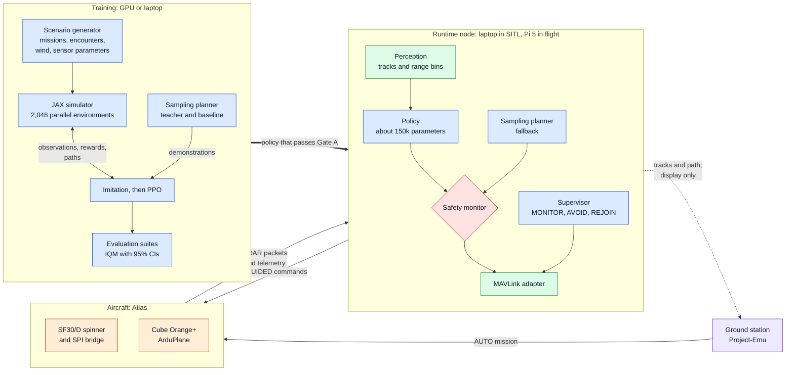
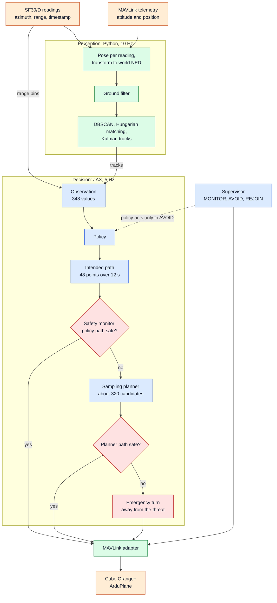
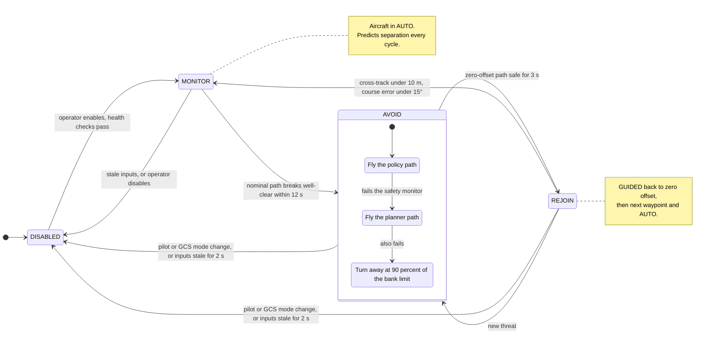
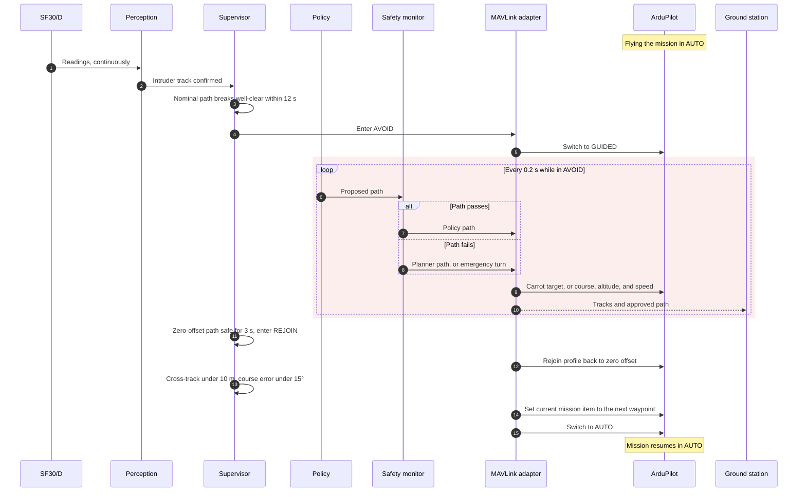
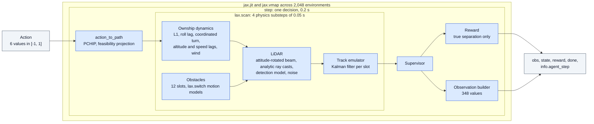
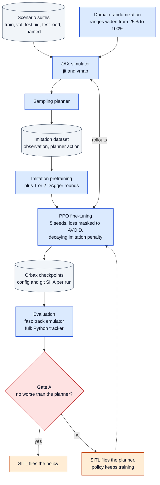
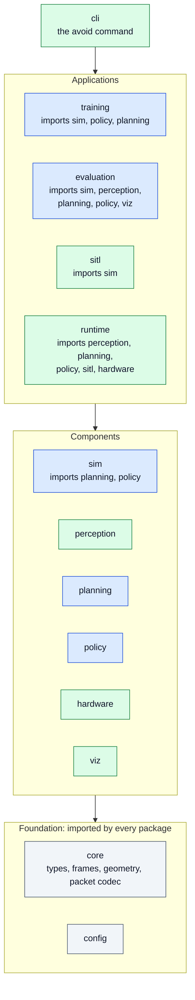
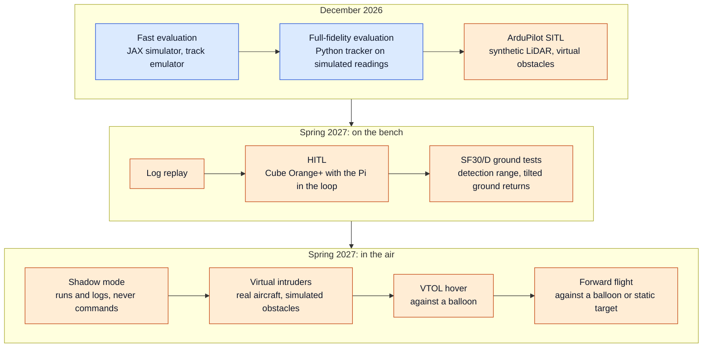

# CUAir Avoidance: Architecture Diagrams

A visual companion to [architecture.md](architecture.md), which stays the source of truth if the two ever disagree. Section references (§) point there.

The diagrams are Mermaid. GitHub renders them natively; in Cursor or VS Code, the "Markdown Preview Mermaid Support" extension renders them in the preview.

**Colors:** blue is simulation and learning code (JAX), green is perception and I/O (Python), orange is ArduPilot and aircraft hardware, red marks safety checks, purple is the ground station, and gray cylinders are stored data.

1. [System overview](#1-system-overview)
2. [Runtime decision loop](#2-runtime-decision-loop)
3. [Supervisor state machine](#3-supervisor-state-machine)
4. [One encounter, end to end](#4-one-encounter-end-to-end)
5. [Inside one simulator step](#5-inside-one-simulator-step)
6. [Training pipeline](#6-training-pipeline)
7. [Code layout](#7-code-layout)
8. [Validation ladder](#8-validation-ladder)

## 1. System overview

Training produces a policy offline. The runtime node runs it against live sensor data and hands approved paths to ArduPilot. In SITL, the "Aircraft" box is ArduPilot SITL plus a synthetic LiDAR, and the node runs on a laptop (§3, §13).

## 2. Runtime decision loop

Every 0.2 s, perception output becomes an observation, the policy proposes a path, and the safety monitor approves it, substitutes the planner's path, or falls back to the emergency turn. The supervisor decides whether the policy acts at all (§5, §8–§10).

## 3. Supervisor state machine

Engagement is rule-based, so the policy decides how to avoid, never whether. Inside `AVOID`, the flown path is chosen again every cycle (§5).

## 4. One encounter, end to end

What happens from first detection to mission resumption. The shaded block is the `AVOID` loop, which runs at 5 Hz (§5, §13.2).

## 5. Inside one simulator step

One call to `step` is one decision. Everything inside compiles into a single XLA program and runs batched across environments (§7).

## 6. Training pipeline

The sampling planner first teaches the policy by imitation, then PPO fine-tunes it. Nothing reaches SITL without passing Gate A against that same planner (§11, §12).

## 7. Code layout

Packages under `src/avoidance/` in three layers. Arrows show which layers import which, and each box lists the packages it imports directly, including siblings in its own layer (§15).

## 8. Validation ladder

Each rung has to pass before the next one runs. Fall 2026 ends at SITL; the hardware rungs are spring 2027 (§12–§14).

