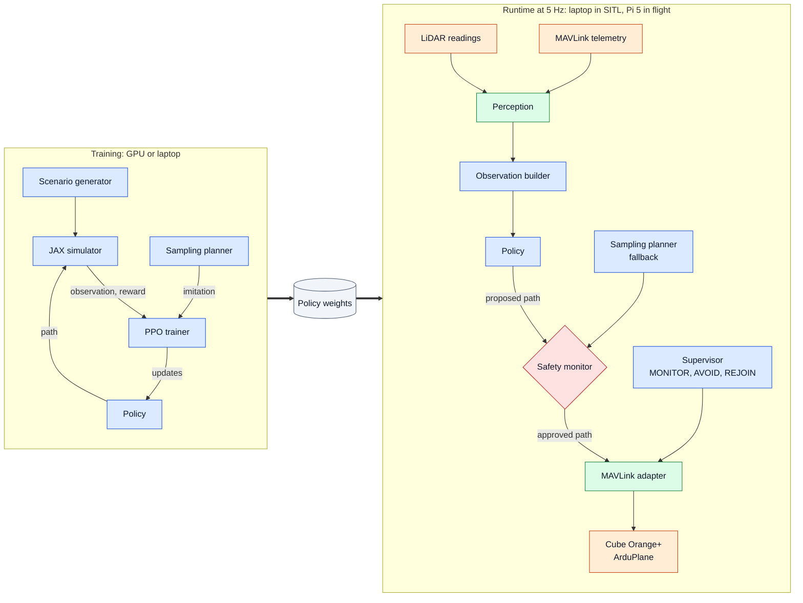

# CUAir Avoidance: Architecture

Learned obstacle avoidance for Atlas, CUAir's ArduPlane QuadPlane, using a spinning single-plane LiDAR. A policy trained in a JAX simulator proposes an avoidance path when a threat appears. A runtime-assurance monitor checks every path before it's flown, a classical planner takes over when the policy's path fails that check, and the aircraft rejoins its ArduPilot waypoint mission afterward.

This document defines interfaces and design decisions. [plan.md](plan.md) sequences the work. Values marked *initial* are starting points to tune, not requirements.

## 1. Scope

**v1 (December 2026)** delivers the simulator, perception, a classical planner, a trained policy, an evaluation suite, and closed-loop demos in ArduPilot SITL. It covers forward flight first and VTOL flight second; VTOL sits behind Gate A in plan.md. Obstacles: other UAS, static structures, balloons, and birds.

**Spring 2027** adds SF30/D hardware bring-up, onboard deployment on the Pi 5, hardware-in-the-loop (HITL) testing on the Cube Orange+, a ground-station display, and flight tests.

**Non-goals:**

- Low-level control. ArduPilot's attitude, TECS, and L1 loops stay in charge; the policy only proposes paths.
- Replacing ArduPilot navigation outside encounters. The mission flies in AUTO until a threat appears.
- Off-board inference in flight. Radio latency and link loss make ground or cloud inference unsafe, and the policy is small enough for the Pi's CPU (§14).
- LLMs or other large pretrained models in the control loop.
- PyTorch. Nothing here needs a second framework.

This repo supersedes `CUAir/avoid` and `CUAir/avoid-2026` and doesn't reuse the 2025 RL branches on `CUAir/avoid`. The C++ pipeline in `CUAir/lidar` is the design reference for perception and defines today's SPI packet format.

## 2. Facts and assumptions

| Item | Value | Source |
|---|---|---|
| Airframe | Atlas (Hermes in CAD): separate-lift QuadPlane, 4 lift motors and 1 forward motor | `CUAir/hitl-dashboard` README; Flight 47 fixture in `CUAir/flight-log-analyzer` |
| Flight controller | Cube Orange+ running ArduPlane | `CUAir/hitl-dashboard` |
| Firmware | Atlas's version is unknown; the team's SITL image is Plane 4.2 | `CUAir/Project-Emu` `run.sh` |
| Airspeed | 13–35 m/s limits, 25 m/s cruise | `Project-Emu/params/quadplane.parm`: `ARSPD_FBW_MIN/MAX`, `TRIM_ARSPD_CM` |
| Bank limit | 65° | `LIM_ROLL_CD 6500` |
| L1 period | 14 s | `NAVL1_PERIOD 14` |
| VTOL | Q-assist below 18 m/s; GUIDED targets are flown as VTOL in Q modes | `Q_ASSIST_SPEED 18`, `Q_GUIDED_MODE 1` |
| Missions | AUTO waypoint laps uploaded by Project-Emu (`POST /wp`); `POST /jump` sends GUIDED plus `DO_REPOSITION` | `CUAir/Project-Emu` |
| Airspace | 150–400 ft AGL (46–122 m); 150 ft minimum turn radius; 100 ft waypoint error; up to two UAS share the airspace | [SUAS 2026 handbook](https://robonation.gitbook.io/suas-resources/section-5-rules-and-requirements/5.3-uas-requirements) §3 and §5.3.7 |
| LiDAR | LightWare SF30/D single-beam rangefinder, spun by a motor with an encoder; a microcontroller emits SPI packets; rated to 120 m | Team |
| SPI packet (v1) | 16 bytes: sync `0xAA55`, version, flags, `uint32 timestamp_us`, `uint16 distance_mm` (max 65.535 m), `uint16 azimuth_cdeg`, intensity, CRC-16-CCITT | `CUAir/lidar` `include/lidar/spi/packet.hpp` |
| Companion computer | Raspberry Pi 5, MAVLink to the Cube over USB | `CUAir/mini-plane-system` |
| Plane-to-ground links | Unknown | — |

Until they're measured, the simulator randomizes the SF30/D rig's rotation rate, reading rate, beam divergence, blind sectors, latency, and real detection range against small aircraft (§7.4).

## 3. System overview



**Colors:** blue is JAX code, green is Python perception and I/O, orange is ArduPilot and aircraft hardware, red is the safety check, and gray is stored data.

Each concept has one implementation wherever possible, so what's trained is what flies:

| Component | Training | Full-fidelity evaluation | SITL | Flight |
|---|---|---|---|---|
| Path representation, planner, safety monitor, supervisor, observation builder, policy | JAX, batched | Same code | Same code, single instance | Same code, single instance |
| Obstacle motion and LiDAR model | JAX simulator | Same | Same functions on CPU drive virtual obstacles and synthetic LiDAR | Real world and real sensor |
| Tracks | JAX track emulator | Python tracker | Python tracker | Python tracker |
| Aircraft dynamics | JAX closed-loop model | Same | ArduPilot SITL | Atlas |

## 4. Conventions

- **Units:** SI internally (meters, seconds, radians, m/s). Degrees appear only at I/O boundaries and in names ending `_deg`.
- **World frame:** local NED (north, east, down) in meters, with the origin at mission home on the ground. Altitude is `h = -z`. The ground is flat at `z = 0` unless terrain randomization is on.
- **Body frame:** FRD (forward, right, down). The *level frame* is the body frame with roll and pitch removed. Observations express relative positions and velocities in it, so banking doesn't rotate them.
- **LiDAR azimuth:** clockwise from the nose in the sensor plane, matching `CUAir/lidar` (`x = d·sin(az)` to the right, `z = d·cos(az)` forward).
- **Frenet frame** along the mission path: `s` is arc length and `d` is lateral offset, positive to the right.
- **Time:** float seconds. Simulator time starts at 0 each episode, runtime uses monotonic seconds, and the MAVLink adapter converts `time_boot_ms`.
- **JAX code** is pure and jit-compatible: no Python branching on traced values, explicit `jax.random` keys, float32, and fixed-size arrays with masks instead of variable-length lists.

## 5. Runtime behavior

The supervisor is a four-state machine shared by the simulator and the runtime node.

| State | Aircraft mode | Behavior | Exit |
|---|---|---|---|
| `DISABLED` | Unchanged | Sends no commands | Operator enables avoidance and health checks pass: `MONITOR` |
| `MONITOR` | AUTO | Predicts separation along the nominal mission path every cycle | A confirmed track violates well-clear along the nominal path within the engagement horizon: `AVOID` |
| `AVOID` | GUIDED | The policy proposes a path; the safety monitor approves it or substitutes the planner's | The zero-offset rejoin path has been predicted safe for 3 s: `REJOIN` |
| `REJOIN` | GUIDED | Follows a planner-generated profile that brings the lateral, altitude, and speed offsets back to zero | Cross-track error under 10 m and course error under 15°: set the mission's current item to the next waypoint, switch to AUTO, go to `MONITOR`. A new threat: `AVOID` |

Rules that hold in every state:

- A pilot RC mode change or a ground-station mode change wins immediately, and the supervisor drops to `DISABLED` until re-enabled.
- In `MONITOR`, stale inputs (telemetry or LiDAR older than 0.5 s) drop the supervisor to `DISABLED`. In `AVOID` or `REJOIN`, the node keeps flying the last approved path for up to 2 s, then hands back to AUTO and alerts the ground station.
- If neither the policy nor the planner produces a path that passes the safety monitor, the node flies the emergency maneuver: a turn at 90% of the bank limit away from the threat (to the right for head-on encounters, following right-of-way convention) at constant altitude, then `REJOIN` once the threat is diverging.
- ArduPilot's geofence stays authoritative.

Engagement is rule-based on purpose. It's predictable, reviewable by the autopilot team, and identical in the simulator and in flight. The policy decides how to avoid, not whether to. The engagement horizon (*initial* 12 s) is tunable; a longer horizon engages earlier and allows gentler maneuvers.

## 6. The intended path (the policy's action)

### 6.1 Mission path and Frenet frame

The nominal path is the mission as ArduPilot flies it: straight legs between waypoints joined by circular arcs at each turn (*initial* arc radius: the turn radius at 45° bank and cruise speed). `planning/path.py` builds it and converts between world NED and Frenet `(s, d)`.

### 6.2 Action vector

The policy outputs `a ∈ [-1, 1]^6` at 5 Hz:

| Index | Meaning | Scaling (*initial*) |
|---|---|---|
| 0–3 | Lateral offset at 4 knots placed 2, 4, 7, and 11 s ahead at the planned speed | `d_k = a_k · 80 m` |
| 4 | Altitude offset from the mission altitude | `Δh = a_4 · 15 m`, clipped to the 46–122 m window with a 5 m margin |
| 5 | Airspeed offset from cruise | `Δv = a_5 · 5 m/s`, clipped to the airspeed limits |

In VTOL mode, index 5 maps to a ground-speed target in `[0, Q_WP_SPEED]`, so the aircraft can stop.

### 6.3 From action to path

1. Interpolate `d(s)` with a monotone cubic (PCHIP) through the current offset and the four knots, holding the last knot beyond the horizon.
2. Blend in the altitude and speed offsets with first-order ramps whose time constants come from the dynamics config.
3. Apply the feasibility projection: sample curvature along the path, and if it exceeds `κ_max = g·tan(φ_nav)/v²` (*initial* `φ_nav = 45°`, which leaves margin below the 65° limit), scale the offset profile toward the current offset by the largest factor `α ∈ (0, 1]` that satisfies the bound (8 fixed bisection steps, for JIT). The reward penalizes `1 − α`, so the policy doesn't lean on the projection. VTOL mode skips the curvature bound and applies acceleration limits instead.
4. Sample the result into a `PlannedPath` of 48 points at 0.25 s spacing (12 s), each with a position and expected arrival time.

```python
# src/avoidance/core/types.py (sketch). Arrays are float32, NED meters, seconds.
class PathAction(NamedTuple):
    lateral_knots: Array      # [4] meters, positive = right of the mission path
    alt_offset: Array         # [] meters, positive = up
    speed_offset: Array       # [] m/s; in VTOL, an absolute ground-speed target

class PlannedPath(NamedTuple):
    points_ned: Array         # [48, 3]
    times: Array              # [48] seconds from now
    feasibility_scale: Array  # [] alpha from the projection
```

### 6.4 Why this representation

- **Viewable:** the 48 points render directly in the viewer and on the ground station.
- **Checkable:** the safety monitor evaluates the exact path the aircraft will fly (§10).
- **Convertible:** it becomes MAVLink commands later without retraining (§13.2).
- **Comparable:** the planner searches the same space, so imitation targets and baseline comparisons are like-for-like.
- **Easy rejoin:** setting every offset to zero rejoins the mission.

## 7. Simulator (`src/avoidance/sim/`)

### 7.1 API and timing

The API is functional, in the style of gymnax:

```python
def reset(key: PRNGKey, params: EnvParams) -> tuple[Obs, EnvState]: ...
def step(key: PRNGKey, state: EnvState, action: Array, params: EnvParams
         ) -> tuple[Obs, EnvState, Array, Array, dict]:  # obs, state, reward, done, info
```

- `EnvParams` holds everything randomized per episode: dynamics, wind, sensor, obstacles, and reward weights.
- `EnvState` holds the ownship, obstacles, sensor buffers, emulated tracks, supervisor state, and mission progress.
- Physics runs at 20 Hz (0.05 s). One `step` is one decision (0.2 s, so 5 Hz), made of 4 physics substeps run with `lax.scan`.
- An auto-reset wrapper plus `jax.vmap` provide batched environments, and the whole PPO update compiles into one `jax.jit`.
- `EnvParams.engagement` is either `"always"` or `"supervised"`:
  - `"always"` lets the policy act on every step. It's used before the supervisor exists and in one ablation.
  - `"supervised"` is the default from Phase 3 on. The supervisor from §5 runs inside the environment, and `info["agent_step"]` is true only in `AVOID`. PPO masks its policy loss on every other step.

### 7.2 Ownship dynamics

The simulator models ArduPilot's closed-loop response, not aerodynamics: the input is a `PlannedPath`, and the output is the trajectory ArduPilot would fly.

**Forward flight:**

- **Path following:** ArduPilot's L1 guidance, with `L1 = ζ·T·v_g/π` (`T = NAVL1_PERIOD`, `ζ = 0.75`) and lateral acceleration `a = 4ζ²·v_g²·sin(η)/L1`. The bank command `φ_cmd = atan(a/g)` is clipped to the bank limit.
- **Roll:** first-order lag with time constant `τ_φ`, plus a roll-rate limit.
- **Turn:** coordinated, `ψ̇ = g·tan(φ)/v_air`.
- **Altitude:** a stand-in for TECS. Climb rate tracks `k_h·(h_cmd − h)`, clipped to the climb and sink limits, with lag `τ_h`.
- **Airspeed:** first-order toward the commanded speed, with lag `τ_v`.
- **Wind:** constant per episode plus Ornstein–Uhlenbeck gusts. Ground velocity is air velocity plus wind.
- **Pitch** (needed for sensor tilt): flight-path angle plus a trim angle.

**VTOL** uses a velocity-command point mass:

- Speed and acceleration limits apply.
- Yaw follows the velocity direction.
- Tilt is `atan(a/g)`, which the sensor model uses.

Mode transitions aren't simulated in v1, so each episode stays in one mode.

| Parameter | *Initial* | Randomized over | Source |
|---|---|---|---|
| Cruise airspeed | 25 m/s | 18–30 m/s | `TRIM_ARSPD_CM` |
| Bank limit | 65° | 50–65° | `LIM_ROLL_CD` |
| L1 period | 14 s | 11–17 s | `NAVL1_PERIOD` |
| Roll time constant `τ_φ` | 0.5 s | 0.3–0.8 s | SITL fit |
| Roll-rate limit | 60°/s | 40–90°/s | SITL fit |
| Climb and sink limits | 5 m/s each | 3–7 m/s | SITL fit |
| Airspeed lag `τ_v` | 3 s | 2–5 s | SITL fit |
| Mean wind | — | 0–10 m/s, any direction | Randomization only |
| Gust standard deviation | — | 0–2 m/s | Randomization only |
| VTOL max speed and acceleration | 5 m/s, 2 m/s² | 3–8 m/s, 1–3 m/s² | SITL fit |

Rows marked "SITL fit" are replaced by `avoid sysid` output (`configs/dynamics/atlas_sitl.yaml`, §13.4) once the first fit lands.

### 7.3 Obstacles

Each environment has 12 obstacle slots with an active mask. Each slot has a shape, a motion model, a class, and a reflectivity. Motion models are dispatched per slot with `lax.switch`.

| Class | Shape (*initial* sizes) | Motion model | Speed |
|---|---|---|---|
| UAS | Sphere, radius 0.8–1.5 m | Constant velocity, constant turn rate, or following its own waypoints | 5–30 m/s |
| Static structure | Vertical cylinder, radius 0.2–3 m, 20–120 m tall (towers, poles, trees) | None | 0 |
| Balloon | Sphere, radius 0.3–1.0 m | Drifts with the wind plus a small random walk | Wind speed |
| Bird | Sphere, radius 0.1–0.4 m, low reflectivity | Ornstein–Uhlenbeck velocity around a mean heading | 5–15 m/s |

Adversarial pursuers are out of scope for v1.

### 7.4 LiDAR model (`sim/lidar.py`)

A single beam spins in the sensor plane. The plane is body-fixed, so it tilts with roll and pitch. For each reading `i` at time `t_i`:

1. The azimuth is `θ_i = θ_0 + 2π·f_rot·t_i`. Readings arrive at rate `R`, so each physics substep generates up to `ceil(R_max·dt)` readings, with a validity mask.
2. The beam direction is the unit vector at `θ_i` in the sensor plane, rotated by the mount offset and by the ownship attitude interpolated to `t_i`.
3. Analytic ray casting runs against spheres, finite vertical cylinders, and the ground plane. Beam divergence is modeled by inflating each target's radius by `range·tan(δ/2)`.
4. The nearest hit in `[r_min, r_max]` survives with probability `p_det(range, target)`. That's a logistic falloff whose midpoint scales with target size and reflectivity.
   - Range noise is Gaussian, with a standard deviation that grows linearly with range.
   - Dropouts and spurious short returns occur at configurable rates.
   - Readings that fall in blind sectors are masked.
5. Readings reach perception after the sensor latency.

| Parameter | *Initial* | Randomized over |
|---|---|---|
| Rotation rate `f_rot` | 10 Hz | 5–20 Hz |
| Reading rate `R` | 5,000 per second | 1,000–10,000 per second |
| Rated maximum range | 120 m | 60–120 m |
| Detection midpoint for a 1 m radius UAS | 80 m | 30–120 m |
| Range noise | 0.05 m + 0.2% of range | 0.5× to 3× |
| Beam divergence `δ` | 0.2° | 0.1–0.5° |
| Blind sectors | None | 0–2 sectors of 10–40° |
| Dropout rate | 1% | 0–10% |
| Latency | 20 ms | 0–100 ms |

Every value above is an assumption until the SF30/D rig is measured. The wide ranges keep the policy from depending on any one of them.

A packet codec (`core/packet.py`) encodes and decodes the v1 SPI packet and a proposed v2 that carries distance in centimeters (655 m maximum) under a new version byte. Simulated, recorded, and hardware streams all pass through it, so the parser is tested before hardware exists.

### 7.5 Track emulator (`sim/track_emulator.py`)

Running clustering and data association inside the training loop would dominate its cost. Training therefore uses an emulator that reproduces the tracker's outputs rather than its algorithm:

- Association uses the ground-truth slot ID, so training sees no clustering or matching errors.
- Each obstacle slot runs a constant-velocity Kalman filter in the world frame. The filter updates only on substeps where the obstacle produced at least one detected reading, and the measurement is the mean of those hit points.
- A track is confirmed after 3 updates and coasts for up to 2 s without updates before it's dropped.
- Up to 8 confirmed tracks are exposed, sorted by predicted time to closest approach.

Full-fidelity evaluation (§12) runs the real Python tracker on simulated readings and measures the emulator's error against it. Phase 3 calibrates the emulator's noise to that gap.

### 7.6 Scenarios and suites (`sim/scenarios.py`, `scenarios/`)

Scenarios are generated around encounters, so almost every episode contains a threat:

1. **Mission:** a lap of 3–6 waypoints inside a flight-boundary polygon, with 200–600 m legs, 30–150° turns, and an altitude of 60–110 m AGL.
2. **Threats:** for each one, the generator picks:
   - an encounter time 8–25 s ahead, and the ownship's nominal position at that time;
   - a miss distance of 0–20 m;
   - an approach geometry: head-on, crossing, overtaking, or converging at a waypoint turn, with configurable weights;
   - a vertical offset within ±3 m and a speed appropriate to the obstacle class.

   It then solves for the obstacle's start state so that the encounter happens if the ownship doesn't avoid.
3. **Background obstacles:** miss distances above 60 m or vertical separation above 20 m. They test false alarms.
4. **VTOL scenarios:** low, slow legs (15–40 m AGL, under 5 m/s) past static structures and drifting balloons.

Named scenarios are fully specified in `scenarios/named/*.yaml`:

- Forward flight: `head_on`, `crossing_left`, `crossing_right`, `overtaking`, `converging_at_turn`, `two_intruder_pincer`, `turning_intruder`, `balloon_on_leg`, `bird_crossing`.
- VTOL: `tower_near_leg_vtol`, `tree_line_vtol`, `balloon_drift_vtol`.

Suites live in `scenarios/suites/*.yaml`. Each is a generator config plus a fixed seed list:

| Suite | Contents | Use |
|---|---|---|
| `train` | Training distribution, fresh seeds | Training only |
| `val` | Training distribution, 500 fixed seeds | Checkpoint selection |
| `test_iid` | Training distribution, 2,000 fixed seeds | Headline results |
| `test_ood` | Faster intruders, several simultaneous threats, stronger wind, shorter detection range, unseen approach mixes | Robustness |
| `named` | Every named scenario × 20 seeds | Regression, demos, SITL |

Changing a suite bumps its `version` field, so results stay comparable.

### 7.7 Reward (`sim/reward.py`)

The reward is computed from the true state only, never from what the sensor saw. Separation is the surface-to-surface distance between an ownship sphere (*initial* radius 1.5 m) and each obstacle.

| Term | Per decision step | *Initial* weight |
|---|---|---|
| Progress | Along-path progress ÷ (cruise speed × step time) | +1.0 |
| Cross-track | `|d| / 80 m` | −0.2 |
| Separation shaping | `Σ max(0, (wc − sep)/wc)²` over obstacles inside their well-clear distance `wc` | −2.0 |
| Action smoothness | Mean squared change in action | −0.1 |
| Feasibility projection | `1 − α` | −0.5 |
| Altitude use | `|Δh| / 15 m` | −0.1 |
| Near miss | First entry below the near-miss distance, per obstacle | −20 |
| Collision | Separation ≤ 0; ends the episode | −100 |
| Geofence or altitude-window violation | Ends the episode | −100 |
| Waypoint reached | Per waypoint | +5 |

*Initial* well-clear and near-miss distances by class: UAS 30 m and 10 m; static structures 10 m and 3 m; balloons 10 m and 3 m; birds 5 m and 2 m.

### 7.8 Episode end

An episode terminates on a collision, a geofence or altitude-window violation, or a completed lap. It's truncated, with bootstrapped values, at 120 s.

## 8. Observation (`src/avoidance/policy/observation.py`)

One JAX builder serves the simulator (batched) and the runtime node (single instance).

| Block | Contents | Size |
|---|---|---|
| Range bins | 72 bins of 5°. Each is the minimum ground-filtered range over the last revolution, encoded as `1 − r/r_max`, stacked over the last 3 decisions | 216 |
| Tracks | 8 slots × 12 features, plus a mask. Features: relative position (3) and velocity (3) in the level frame, range, time and distance at closest approach, time since last update, confirmed flag, size | 104 |
| Ownship | Airspeed, ground speed, roll, pitch, climb rate, wind estimate (2), flight-mode one-hot (2) | 9 |
| Mission | Distance to the next waypoint, cross-track offset, course error (sin, cos), next turn angle (sin, cos), distance to the geofence, altitude margins to the floor and the ceiling | 9 |
| Context | Supervisor state one-hot (4), previous action (6) | 10 |

That's 348 values. Normalization uses fixed scale constants stored with each checkpoint, not running statistics, so runtime inputs match training exactly.

Range bins are always built by this builder from raw readings and pose, in every stage. Tracks come from the emulator in training and from the Python tracker everywhere else. The ground filter is a simple geometric rule: drop hits less than 3 m above ground level. It exists in both JAX (here) and NumPy (perception), and a parity test keeps them identical.

## 9. Perception (`src/avoidance/perception/`)

Perception is Python and NumPy. It runs at 10 Hz in the runtime node and in full-fidelity evaluation.

1. **Ingest** readings from any source through the packet codec: simulator export, the SITL synthetic LiDAR, recorded logs, or SPI hardware.
2. **Interpolate pose.** Ownship attitude and position come from telemetry, interpolated to each reading's timestamp. Telemetry must arrive at 20 Hz or faster; readings with no pose within 0.3 s are dropped.
3. **Transform** hits to world NED. This removes both ego-motion and banking distortion.
4. **Filter the ground** with the §8 rule. It catches the tilted scan plane striking the ground in turns: at the 46 m altitude floor, any bank steeper than about 22° puts ground within 120 m.
5. **Cluster** hits from the last revolution with DBSCAN. The neighborhood radius grows with range, because beam spacing does.
6. **Associate** clusters with tracks using gated Hungarian matching on Mahalanobis distance (`scipy.optimize.linear_sum_assignment`).
7. **Track** each object with a constant-velocity Kalman filter in the world frame, so static objects show near-zero velocity. The lifecycle is tentative, confirmed after 3 hits, coasting for up to 2 s, then deleted.
8. **Emit** tracks in the same format the emulator produces.

Compared with `CUAir/lidar`, this adds pose interpolation, a world-frame tracker, ground filtering, range-scaled clustering, and v2 packets.

## 10. Planning and runtime assurance (`src/avoidance/planning/`)

All of this is `jax.numpy`. It's vmapped over candidate paths at runtime, and additionally over environments in training.

**Threat prediction.** Each confirmed track is propagated at constant velocity over the 12 s horizon. Its radius is inflated by `σ_pos + σ_vel·t`, capped at 25 m, to cover maneuvering intruders.

**Path evaluation** (`evaluate_path`). For a `PlannedPath`, this returns the minimum predicted separation per track, the geofence and altitude-window margins, and the feasibility scale. A path is safe when every predicted separation exceeds the class's well-clear distance and every margin is positive.

**Sampling planner** (`plan`):

- **Candidates:** about 320 per cycle, made up of a fixed grid (7 lateral profiles × 3 altitude offsets × 3 speed offsets), 256 random samples, and the previous cycle's choice.
- **Selection:** it picks the lowest-cost safe candidate. Cost adds deviation from the mission path, action change, risk (the separation-shaping term from §7.7), and lost progress.
- **No safe candidate:** it returns the one with the largest minimum separation and flags an emergency.

The planner serves as the imitation teacher, the benchmark, and the runtime fallback.

**Safety monitor** (`rta_check`). This runs `evaluate_path` on the policy's proposed path, with stricter inflation than the planner uses (*initial* `σ_vel` of 2 m/s, versus the planner's 1 m/s):

1. If the policy's path passes, fly it.
2. If it fails, fly the planner's path, provided that one passes.
3. If neither passes, fly the emergency maneuver (§5).

Every decision and its reason is logged. During RL training the monitor is off by default, so the policy has to be safe on its own. Evaluation reports the policy both with and without the monitor, along with the monitor's intervention rate.

## 11. Learning (`src/avoidance/policy/`, `src/avoidance/training/`)

**Networks** (Flax Linen, matching the PureJaxRL reference code):

- The actor and critic are separate MLPs, each with two hidden layers of 256 tanh units.
- The actor outputs a Gaussian mean with a state-independent log standard deviation. The environment clips actions to `[-1, 1]`.
- The actor has about 150k parameters.

**PPO** (fully jitted, following PureJaxRL). *Initial* settings:

- 2,048 environments on a GPU, or 64 on a laptop CPU.
- 128-step rollouts.
- GAE with γ = 0.99 and λ = 0.95.
- Clip range 0.2, with 4 epochs × 8 minibatches per update.
- Learning rate 3e-4, decaying linearly.
- Gradient-norm clip 0.5.

The policy loss is masked to `AVOID` steps.

**Imitation, then RL** (fine-tuning our own model):

1. Roll out the sampling planner in the simulator and record `(observation, planner action)` pairs.
2. Train the actor by regression onto the planner's actions. One or two DAgger rounds relabel states that the policy itself visits.
3. Start PPO from those weights. A behavior-cloning penalty decays to zero over the early part of training, so early PPO updates don't erase what imitation taught.

**Domain randomization** covers every range in §7.2–§7.4, plus obstacle sizes and speeds, sampled per episode. The ranges widen linearly from 25% to 100% of their span over the first half of training.

**Infrastructure:**

- Configs are frozen dataclasses with a `tyro` CLI.
- Every run writes its resolved config, git SHA, and metrics to `runs/<run_id>/`.
- Checkpoints use Orbax.
- Weights & Biases logging is optional; its API key lives in `.env`.
- GPUs use `jax[cuda12]`; laptops use CPU JAX.

**Planned ablations** for the December report:

- Imitation initialization versus PPO from scratch.
- Hybrid observations versus tracks only versus ranges only.
- Altitude offsets on versus off.
- Domain randomization on versus off, measured on `test_ood`.
- The emulator versus the real tracker at evaluation time.

**Stretch goals** (after Gate A):

- A GRU policy, for longer memory.
- PPO-Lagrangian, treating near misses as a constraint.
- Prioritized level replay, for an adaptive curriculum.
- An attention encoder over tracks.

## 12. Evaluation (`src/avoidance/evaluation/`)

**Metrics per episode:**

- Safety: collision, near miss, minimum separation, time inside well-clear.
- Mission: lap completed, extra path length (%), added time, maximum cross-track offset.
- Engagement: time spent and number of engagements, false-alarm engagements (no true threat), safety-monitor intervention rate.
- Flying quality: maximum bank used, action smoothness.

**Protocol:**

- Train at least 5 seeds per configuration and evaluate each on the fixed suites.
- Report interquartile means with 95% stratified-bootstrap confidence intervals, plus the probability of improvement over the planner (via `rliable`).
- Because suites use fixed seeds, policy-versus-planner comparisons are paired: a bootstrap over scenario seeds of the per-scenario difference.
- Every report includes the worst episodes, rendered in the viewer.

**Configurations compared:** no avoidance (AUTO only), the sampling planner, an imitation-only policy, an imitation-plus-PPO policy, and PPO from scratch. Each is evaluated with and without the safety monitor.

**Two fidelity levels:**

- Fast evaluation with the track emulator (JAX, batched).
- Full evaluation with the Python tracker on simulated readings (NumPy, multiprocess).

Both are reported, and the difference between them is itself a tracked metric.

**Gate for flying the policy in SITL** (Gate A in plan.md):

- With the safety monitor on, the 95% confidence interval of (policy − planner) collision-plus-near-miss rate must include or lie below zero, on both `test_iid` and `named`.
- Lap completion must be at least 98%.

If the policy misses the gate, the planner flies in SITL and the policy keeps training.

## 13. SITL integration (`src/avoidance/sitl/`, `docker/sitl/`)

### 13.1 Components

`docker compose -f docker/sitl/compose.yaml up` starts the simulated aircraft side:

1. **ArduPilot SITL.** ArduPlane built from the official repository for the host architecture (arm64 on Apple Silicon), pinned to Atlas's firmware version.
   - Frame: `quadplane`, the separate-lift frame that matches Atlas (Project-Emu defaults to `quadplane-tilt`).
   - Parameters: CUAir's, adapted from `Project-Emu/params/quadplane.parm`.
   - Home: Skyway Range (36.2146959, −96.006745).
2. **mavlink-router**, which fans MAVLink out to the other services and, optionally, to Project-Emu.

These run as `avoid` subcommands:

3. **Scenario runner** (`avoid sitl run <scenario>`):
   - Uploads the mission (`MISSION_ITEM_INT`), arms, and takes off.
   - Moves virtual obstacles in SITL time, using the simulator's obstacle functions on CPU.
   - Records ground-truth metrics.
4. **Synthetic LiDAR:**
   - Reads SITL's true pose (`SIMSTATE`) at 50 Hz.
   - Runs the simulator's LiDAR model on CPU against the scenario's obstacles.
   - Streams v2 packets over UDP.
5. **Runtime node** (§14). It runs on the laptop and, as in flight, uses the EKF estimate (`ATTITUDE`, `LOCAL_POSITION_NED`).
6. **Viewer.** Rerun, showing truth, readings, tracks, candidate paths, the approved path, and the supervisor state.

### 13.2 MAVLink adapter

The adapter turns an approved `PlannedPath` into commands. Two strategies share one interface, and Phase 5 picks one by measuring path-tracking error in SITL.

**Carrot.** Works on older firmware.

- In GUIDED, stream a target point on the path at 5 Hz, about one L1 distance ahead (roughly 85 m at 25 m/s).
- Use `SET_POSITION_TARGET_GLOBAL_INT` or `MAV_CMD_DO_REPOSITION` for the target point.
- Set airspeed with `MAV_CMD_DO_CHANGE_SPEED`.

**Course.** Needs firmware that supports these commands.

- Run the path follower on the companion computer.
- Stream `MAV_CMD_GUIDED_CHANGE_HEADING`, `MAV_CMD_GUIDED_CHANGE_ALTITUDE`, and `MAV_CMD_GUIDED_CHANGE_SPEED`.

**Mode changes** use `MAV_CMD_DO_SET_MODE`. Before returning to AUTO, the adapter sets the mission's current item to the next waypoint with `MAV_CMD_DO_SET_MISSION_CURRENT`. In VTOL, `Q_GUIDED_MODE 1` makes the same GUIDED targets fly as VTOL.

### 13.3 Simulator-to-SITL gap

The same named scenarios run both in the JAX simulator and in SITL. The report compares:

- trajectories: mean position difference over time, aligned at engagement;
- minimum separation;
- extra path length.

A large gap triggers a dynamics refit.

### 13.4 System identification

`avoid sysid` flies scripted GUIDED maneuvers in SITL: heading steps, altitude steps, speed steps, and S-turns. It logs the response and fits the §7.2 parameters by least squares, writing `configs/dynamics/atlas_sitl.yaml`. Once real ArduPilot `.BIN` logs arrive, the same fit runs on them (parsed with pymavlink) and writes `atlas_flight.yaml`.

## 14. Runtime node and onboard deployment (`src/avoidance/runtime/`, `src/avoidance/hardware/`)

The runtime node combines perception, the observation builder, the policy, the planner, the safety monitor, the supervisor, and the MAVLink adapter. It runs on a laptop against SITL in December, and on the Pi 5 in spring. `hardware/` holds the SPI reader for the SF30/D bridge (spring).

**Compute.** The Pi 5 is enough; avoidance doesn't need a Jetson.

- The actor has about 150k parameters (0.6 MB), and one forward pass takes well under a millisecond on the Pi's CPU.
- The planner and safety monitor check about 320 paths × 48 points × 8 tracks per cycle. That's a few hundred thousand distance checks, which is also small.
- Target: the whole node uses under 25% of one core at 5 Hz, to be measured on the Pi.

If the team buys a Jetson for other work, such as onboard camera detection, get an Orin Nano. The original Jetson Nano is discontinued and stuck on an old software stack.

**Runtime software.** The node runs the same JAX code on the Pi's CPU (JAX supports 64-bit ARM Linux), compiling once at startup before takeoff. ONNX export is available if another runtime is ever needed.

**Processes.**

- `mavlink-router` owns the Cube's USB serial link.
- `mini-plane-system` and the runtime node connect to it over UDP, which needs a small change to `mini-plane-system`.
- The node reads SPI packets from the bridge and logs every input and output for replay.

**Safety.**

- The operator enables or disables avoidance from the ground station.
- RC mode changes always win.
- Stale inputs and failed health checks stop commanding, as described in §5.
- The node never commands outside AUTO or GUIDED.
- ArduPilot's geofence stays authoritative.

**Ground display.** Tracks and the approved path go to the ground station for display. The display isn't safety-critical, so its transport depends on whichever links exist.

**Test ladder**, in order:

1. Log replay.
2. HITL: the Cube Orange+ running ArduPilot's simulation on the flight hardware, with the Pi in the loop.
3. SF30/D ground tests: detection range against a UAS-sized target, and ground returns when the sensor is tilted.
4. Shadow-mode flights: the node runs and logs but never commands.
5. Flights with virtual intruders injected into perception: a real aircraft with simulated obstacles.
6. VTOL hover against a balloon.
7. Forward flight against a balloon or a static target.

## 15. Repository layout

```
avoidance/
├── README.md, architecture.md, plan.md
├── pyproject.toml, uv.lock, .pre-commit-config.yaml, .env.example
├── src/avoidance/
│   ├── cli.py            # `avoid` entry point: train, eval, bench, view, bc-data, sysid, sitl
│   ├── config.py         # frozen dataclass configs, YAML load/save
│   ├── core/             # types, frames, geometry, packet codec
│   ├── sim/              # env API, dynamics/ (fixed_wing, vtol, wind), obstacles, lidar,
│   │                     # track_emulator, scenarios, reward
│   ├── perception/       # pose interpolation, ground filter, clustering, tracker
│   ├── planning/         # path, evaluate_path, sampling planner, safety monitor, supervisor
│   ├── policy/           # networks, observation builder
│   ├── training/         # ppo, imitation, randomization, checkpoints, logging
│   ├── evaluation/       # suite runner, metrics, statistics, reports, emulator calibration
│   ├── sitl/             # MAVLink I/O and adapter, synthetic LiDAR, scenario runner, sysid
│   ├── runtime/          # the avoidance node
│   ├── hardware/         # SPI reader for the SF30/D bridge (spring)
│   └── viz/              # Rerun logging helpers
├── configs/              # dynamics fits, training presets
├── scenarios/            # named/ and suites/ (YAML)
├── docker/sitl/          # ArduPilot SITL image and compose file
├── docs/                 # plans/ (per-phase implementation plans), results/
└── tests/                # mirrors src/avoidance/
```

## 16. Tooling and quality

- **Packaging:** Python 3.12 managed with `uv`; one package (`avoidance`) with a console script, `avoid`.
- **Static checks:** `ruff` for lint and formatting, `pyright` for types.
- **Tests:** `pytest`, plus `hypothesis` for property tests.
- **Secrets:** `pre-commit` runs ruff, pyright, and `gitleaks`, so keys never land in this public repo. Secrets live in `.env` (git-ignored), and `.env.example` lists their names.
- **CI:** GitHub Actions on Linux CPU runs lint, type checks, tests, and a 60-second training smoke test.
- **Key tests:**
  - Ray intersections agree with a brute-force reference.
  - The steady-turn radius is within 2% of `v²/(g·tan φ)`.
  - Generated encounters really collide when avoidance is off.
  - The planner finds safe paths in the canonical scenarios.
  - The safety monitor rejects every path in a set of known-unsafe cases.
  - Packet codec round trips succeed.
  - The same seed reproduces the same rollout.
  - The JAX and NumPy ground filters agree.
  - The tracker's error stays within bounds on synthetic data.
- **Benchmarks** (`avoid bench`): simulator steps per second, planner latency, runtime-node latency.

## 17. Decision log

| Decision | Choice | Main reason | Rejected |
|---|---|---|---|
| Where inference runs in flight | Onboard Pi 5 (laptop during SITL) | Radio latency and link loss; the model is tiny | Ground server or cloud |
| Policy action | Intended path as offsets from the mission path | Viewable, checkable before flight, convertible to MAVLink, shared with the planner | Attitude or surface commands; free-form waypoints |
| Training simulator | Custom JAX | Thousands of parallel environments, and a 2D LiDAR needs only analytic ray casts | Gazebo, Unreal, Isaac Sim, AirSim |
| Framework | JAX only | JAX is strongest at vectorized simulation and end-to-end jitted training, and one framework is simpler | Adding PyTorch |
| "Fine-tune a model with RL" | Imitate the sampling planner, then PPO | Feasible, measurable, and fast onboard | Fine-tuning an LLM |
| Safety | Runtime-assurance monitor, planner fallback, emergency maneuver | The policy can't be verified directly; the monitor can | Trusting the policy alone |
| Engagement | Rule-based supervisor | Predictable and reviewable; the policy decides how to avoid, not whether | Learned engagement |
| Perception | Re-implemented in Python in this repo | One tracker for full-fidelity evaluation, SITL, and flight | Extending the C++ pipeline |
| Perception during training | JAX track emulator | Clustering and association in the training loop would dominate its cost | Full tracker in training |
| Altitude | Offsets up to ±15 m, ablated | The 2D sensor can't see vertical separation, but training may show small offsets help | Unlimited 3D maneuvers |
| Regimes | Forward flight, then VTOL behind Gate A | Both are in v1 per the project owner; sequencing limits schedule risk | VTOL first |

## 18. Risks and open questions

| Risk | Effect | Mitigation | Owner and timing |
|---|---|---|---|
| SF30/D rig parameters unknown | Sensor model could be wrong | Wide randomization; measure rotation rate, reading rate, divergence, mount, and blind sectors | Rig builder; before Phase 1 ends |
| v1 packet caps range at 65.5 m | Half the rated range is unusable | v2 packet with centimeter distances; the codec is ready in Phase 0 | Bridge firmware owner; spring |
| Real detection range against small aircraft unknown | Less warning than planned | Randomized detection model; spring ground tests | Spring |
| Ground returns in banked turns | False tracks | Ground filter; banked-turn tests at 46 m AGL in the simulator | Phase 3 |
| Atlas firmware version unknown | Limits adapter options | The carrot adapter works on older firmware; confirm the version | Autopilot team; by Phase 2 |
| Autopilot team approval for onboard GUIDED takeover | Blocks flight integration | Share this document; fly shadow mode first | Spring |
| `mini-plane-system` owns the serial port | Blocks onboard commanding | `mavlink-router`, plus a small change to `mini-plane-system` | Spring |
| Plane-to-ground links unknown | Ground display transport undecided | The display isn't safety-critical; decide in spring | Spring |
| Both regimes by December, solo | Schedule slip | VTOL behind Gate A (plan.md) | November 22 |
| Dynamics fitted to SITL only | Gap between simulation and the real aircraft | Refit on real `.BIN` logs when they're available | Spring |
| Reward hacking: climbing out of the scan plane, leaning on the projection, or relying on the monitor | A policy that scores well but is unsafe | True-state rewards, projection penalty, monitor off in training, review of worst episodes | Phase 4 |
| SUAS 2027 rules unpublished | The obstacle model could shift | Suites are versioned and cheap to change | When the rules are published |
